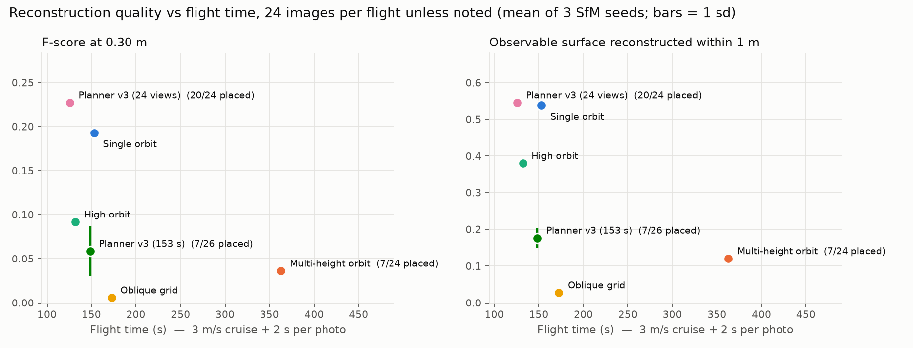
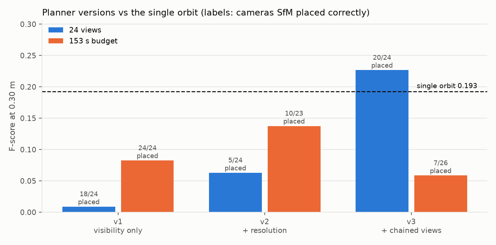
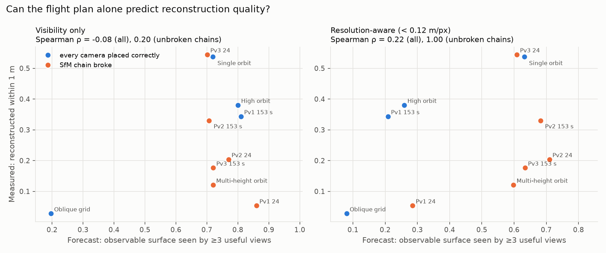
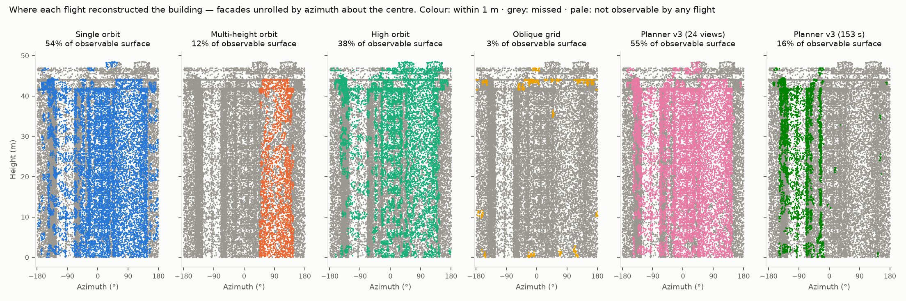
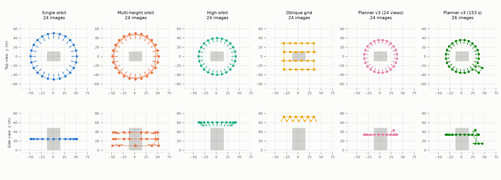
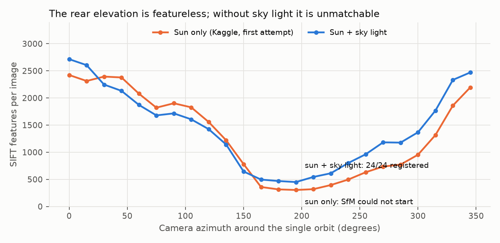
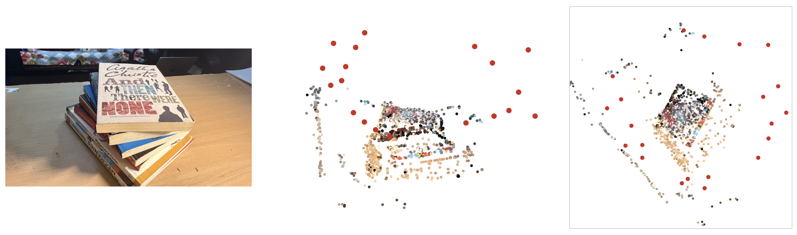

# Drone Path Optimisation for 3D Reconstruction of Civil Structures

B.Tech Project (CVD 411), Department of Civil Engineering, IIT Delhi.
Utkarsh (2023CE10878) · Supervisor: Prof. Saikat Sarkar

A drone photographs a structure and photogrammetry rebuilds it in 3D. **Where the drone
flies decides how good that model is** — and flight time is limited by the battery. This
project builds a simulation harness that measures reconstruction quality against exact
ground truth, compares standard survey flights, and tests a planner that chooses
viewpoints from the structure's own geometry.

Simulation is what makes the comparison possible: on a real building the true geometry is
unknown, so reconstruction error can't be measured. Here the 3D model *is* the ground truth.

## Results

Ten flights of one 12-storey building (plus a lighting ablation), each rendered, reconstructed with three SfM seeds and
scored against the true mesh. Full table: [`results/results_table.md`](results/results_table.md).

| Flight | Flight time | Cameras placed correctly | F-score @ 0.30 m | Surface within 1 m | Median error |
|---|--:|--:|--:|--:|--:|
| Single orbit (mid-height) | 153 s | 24/24 | 0.193 | 54% | 2.6 cm |
| Multi-height orbit (3 rings) | 363 s | 7/24 | 0.036 | 12% | 2.5 cm |
| High orbit (looking down) | 132 s | 24/24 | 0.092 | 38% | 3.7 cm |
| Oblique grid | 173 s | 24/24 | 0.006 | 3% | 2.4 cm |
| **Planner v3 (24 views)** | **126 s** | 20/24 | **0.227** | **54%** | **1.9 cm** |
| Planner v3 (153 s budget) | 148 s | 7/26 | 0.059 | 18% | 12.4 cm |



**What the experiments show**

1. **The final planner beats the best standard flight while flying less.** Planner v3 with 24
   views scores F = 0.227 against the single orbit's 0.193 (+18%), with a 26% lower median error
   (1.9 vs 2.6 cm) and the same coverage, in 126 s instead of 153 s. Its plan is a closer, higher orbit
   (36 m out at 34 m altitude, against 50 m out at 24 m), with every camera tilted down at the
   building's centre and one of the 24 views raised to 44 m. The planner chose it for finer
   ground resolution on the facades.
2. **More flying is not better flying.** The multi-height orbit flies 2.4× longer than the
   single orbit and reconstructs a fifth of the surface: its three rings are too far apart in
   height for SfM to join them, so only one ring's cameras end up correctly placed. Image
   *connectivity* matters more than image count.
3. **Visibility is a poor forecast; resolution plus connectivity is a good one.** Counting
   which surface each camera can see (no images needed) does not rank the flights at all
   (Spearman ρ = −0.08). Requiring each view to resolve the surface finer than 0.12 m/px ranks
   every flight whose SfM chain held together exactly (ρ = 1.00). The remaining failures are
   chain breaks, which the v3 partner rule predicts (below).
4. **Lighting matters as much as some flight-path changes.** Re-flying the single orbit with
   the sun alone (no diffuse sky light, run_012) leaves the shaded rear elevation with about 45%
   fewer SIFT features; 4 of 24 images drop out, F falls 13% (0.193 → 0.167), coverage within
   1 m falls from 54% to 44% and the median error nearly doubles (2.6 → 4.9 cm). The first
   sun-only attempt on Kaggle failed outright. Every other run uses sun + sky light.
5. **Limits of a geometry-only planner.** Even v3 loses four images on the plain rear wall,
   which ray casting cannot tell apart from a textured one. The budgeted variant, given more
   freedom, folds in low-altitude views whose chain breaks — it is the clearest negative result
   here, and the reason the fixed-24 planner is the recommended one.



### How the planner got there (v1 → v2 → v3)

| Version | Rule added | What went wrong / right |
|---|---|---|
| v1 | cover each surface point with ≥3 views at < 70° incidence | picked distant, oblique views; ranked flights no better than chance |
| v2 | + a view only counts if it resolves the surface at < 0.12 m/px | right views, but SfM could not join them: 5/24 placed |
| v3 | + every view needs **≥2 partner views** (≥50% shared surface, ≤20° apart) | 20/24 placed; best F-score of any flight |

The v3 partner rule was not guessed: in the earlier runs, the 101 images that met it were
registered 92% of the time, against about 45% for images that did not.






### Limitations

- **One building.** Orbits are near-optimal for a compact tower; a long, low or courtyard
  structure is where planned flights should gain most, and is untested here.
- **Sparse reconstruction only.** Dense MVS needs a CUDA GPU; all accuracy numbers are on the
  sparse SfM cloud, so absolute recall is low for every flight. Comparisons are like-for-like.
- **Texture-blind planning.** The planner sees geometry, not appearance, so it cannot anticipate
  featureless surfaces. Image-based feature prediction is the obvious next step.
- **Idealised flight model.** Constant 3 m/s and 2 s hover; no wind, battery curve or GPS error.


### Real-photo test

To check the pipeline outside simulation, a stack of books was photographed with an iPhone 17:
21 photos taken walking around it, at three zoom settings (26, 21 and 17 mm equivalent). The
pipeline gives each zoom setting its own camera, starts from the focal length in the photo
metadata and lets COLMAP calibrate each lens.

| | Real photos (book stack) | Simulation (single orbit) |
|---|--:|--:|
| Photos placed | 21/21, all 3 seeds | 24/24 |
| 3D points | ≈3,190 | ≈3,800 |
| Reprojection error | 1.0 px | 0.3 px |

COLMAP's focal estimates landed 8–14% above the metadata values and agreed across seeds to
within 0.3%. There is no ground-truth model of the books, so this shows the pipeline works on
real photos, not how accurate it is on them. The photos themselves are not in the repository.




## Pipeline

```
plan viewpoints ──► render images ──► structure-from-motion ──► compare with ground truth
 strategies.py        render.py          reconstruct.py            evaluate.py
 planner.py          (Blender/bpy)       (COLMAP/pycolmap)
```

One command runs an experiment end to end and appends a row to `results/results.csv`:

```bash
PYTHONPATH=src python -m btp.pipeline --strategy orbit_high --run-id run_004
```

| Stage | What happens |
|---|---|
| **Scene** | 12-storey RC residential block (photogrammetry-textured, 28.9 × 21.3 m plan, 48.7 m tall), textured ground plane, sun **plus sky light** |
| **Render** | Cycles, 20 mm lens on a 36 mm (full-frame) sensor, 768 × 1024 portrait, 32 samples |
| **Reconstruct** | SIFT → exhaustive matching → incremental SfM, one calibrated pinhole camera; repeated with **3 random seeds** |
| **Evaluate** | Align recovered cameras to true ones (RANSAC + Umeyama similarity; a camera within 0.5 m is *correctly placed*) → pose error, point accuracy, and completeness of the *observable* surface |

### How the reconstruction works (COLMAP SfM)

1. **Feature extraction** — SIFT finds distinctive patches (corners, texture specks) in each image.
2. **Matching** — every image pair is compared; similar descriptors are proposed as the same physical point.
3. **Geometric verification** — RANSAC keeps only matches consistent with one camera geometry; wrong matches die here.
4. **Incremental mapping** — start from the best image pair, triangulate points, then register one camera at a time against points already built.
5. **Bundle adjustment** — jointly refine every camera pose and 3D point to minimise reprojection error.

The output is the camera poses plus a **sparse** point cloud. Dense multi-view stereo needs a
CUDA GPU, which this project did not have, so all quality numbers are on the sparse cloud — the
cheap tier of the evaluation. Comparisons between strategies are like-for-like.

### Metrics

| Metric | Meaning |
|---|---|
| Registered | images COLMAP could place |
| Correctly placed | registered cameras within 0.5 m of their true position after robust alignment — SfM sometimes registers images into a wrong, folded chain |
| Track length | mean number of images that see each 3D point (≥3 for reliable triangulation) |
| Pose error | distance between each recovered camera and its true position, after alignment |
| Median error | median distance from reconstructed points to the true surface |
| Precision@τ | share of reconstructed points within τ of the true surface |
| Recall@τ | share of the **observable** true surface with a reconstructed point within τ |
| F@τ | harmonic mean of the two; τ = 0.30 m headline, 1.0 m for coarse coverage |
| Forecast | from the flight plan alone (no images): share of observable surface seen by ≥3 useful views (< 70° incidence, < 0.12 m/px) |

Recall is measured over a fixed *observable surface*: every part of the building that any
flight or planner candidate could see (91% of it). Faces resting on the ground or hidden inside
the model are excluded, and the denominator is the same for every flight.

### Flight cost

Every flight is a closed tour back to its start at 3 m/s, plus 2 s hover per photo. A leg that
would cut through the building is replaced by a detour round it — the same rule for every
strategy.

### The planner

1. **Candidates** — 492 poses on rings at six heights and two standoffs, plus a ring above
   the roof. Each position is offered aimed level at its own height (a facade view) and aimed
   at the structure's centre (an oblique view taking in a second facade or the roof).
2. **Scoring by ray casting** — which surface samples each candidate sees, at what distance
   and incidence angle. Pure geometry, no images. A view is *useful* to a sample if incidence
   < 70° and effective ground resolution (distance / focal length / cos incidence) < 0.12 m/px.
3. **Coverage objective** — a sample's utility rises with each useful view up to three, and a
   view counts only if it is ≥5° from the views already counted for that sample (parallax). This
   is a concave function of a coverage count, i.e. submodular.
4. **Chain constraint (v3)** — every chosen view needs at least two *partners*: other chosen
   views sharing ≥50% of its visible surface, within 20° of its direction. Without this, SfM
   cannot register the images however good the coverage looks.
5. **Search** — start from the best whole ring of candidates (always chained), then swap views
   while the objective rises and the chain constraint holds; route with 2-opt / OR-Tools TSP.
   Legs through the building become detours round it.

Two modes: **24 views** (equal image count with the baselines) and **153 s budget** (equal
flight time with the single orbit — the orienteering formulation, adding the view with the best
gain per extra second, after Khuller, Moss & Naor).

Strategy names in `pipeline.py`: `planner`, `planner_budget153` (v1), `planner_res`,
`planner_res_budget153` (v2), `planner_chain`, `planner_chain_budget153` (v3).

## Reproduce

```bash
uv venv -p 3.13 .venv && VIRTUAL_ENV=.venv uv pip install -e . pytest
# model: "Arabic Neoclassical Tall Residential Complex Building" (Carthage Studio, Fab, free
# personal licence) -> assets/Blender/Blender_004.blend with its Textures/ folder.
# The project's copy: https://drive.google.com/file/d/1uo8s26VfG7t6ITqX8a8mtWOHmOuG_w0S/view?usp=sharing
./scripts/run_all.sh          # ~25 min per strategy on 2 CPUs
python -m pytest tests

# real photos: one folder of JPEG/HEIC photos -> runs/<run-id>, results/figures/<run-id>.png
python -m btp.real --src ~/Downloads/real/books --run-id real_books
```

Runs on CPU only; peak memory stays under 7 GB because Cycles caps textures at 2K
(`texture_limit_render`), which is still finer than a 768 × 1024 render can resolve.

## Repository

```
src/btp/       pipeline code (geometry, render, strategies, planner, reconstruct, evaluate, report, real)
runs/run_*/    poses.json, rendered_poses, SfM stats and evaluation per seed
runs/real_books/  real-photo test: camera priors and SfM stats per seed
results/       results.csv, results_by_seed.csv, results_table.md, figures/
notebooks/     the original Kaggle notebooks (outputs stripped)
tests/         geometry, alignment and routing checks
```

## References

- Smith et al., *Aerial Path Planning for Urban Scene Reconstruction: A Continuous Optimization
  Method and Benchmark*, SIGGRAPH Asia 2018 — reconstructability heuristic.
- Maboudi et al., *A Review on Viewpoints and Path Planning for UAV-Based 3-D Reconstruction*,
  IEEE JSTARS 2023.
- Schönberger & Frahm, *Structure-from-Motion Revisited*, CVPR 2016 — COLMAP.
- Khuller, Moss & Naor, *The Budgeted Maximum Coverage Problem*, IPL 1999.
